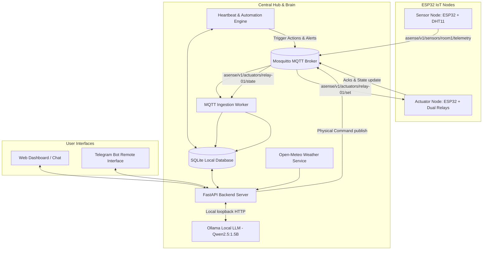

# A-SENSE: Autonomous Multi-Agent Home Management Framework

> **A Privacy-First, Edge-Native Smart Home Orchestration Platform using Model Context Protocol (MCP), Local LLMs, and Distributed ESP32 IoT Nodes.**

[](https://opensource.org/licenses/MIT)
[](https://www.python.org/downloads/)
[](https://ollama.ai)
[](https://www.raspberrypi.com/)
[](https://www.espressif.com/)

---

## 🌟 1. Project Overview

**A-SENSE** is an autonomous, localized smart-home environment management platform. Unlike conventional IoT setups that send raw telemetry and voice data to third-party clouds, A-SENSE executes all intelligence locally on a **Raspberry Pi 5** using quantized local language models (`qwen2.5:1.5b` via Ollama) paired with deterministic tool execution engines.

Distributed **ESP32 microcontroller nodes** communicate via authenticated **MQTT (Mosquitto)**, enabling real-time environmental telemetry ingestion and low-latency physical appliance actuation.

---

## 🏗️ 2. Architecture & How It Works



### The 7-Step Operational Loop:
1. **Telemetry Streaming:** The Sensor Node samples ambient temperature and humidity every 10 seconds and transmits encrypted JSON packets over MQTT.
2. **Persistence & Auditing:** The MQTT worker ingests telemetry, checks data freshness, and commits readings into an ACID-compliant SQLite audit store.
3. **Multi-Channel Interaction:** Users issue natural-language queries or commands via the LAN Web Dashboard or the authenticated Telegram Bot.
4. **Hybrid Intent Processing:**
   - **Deterministic Fast-Paths:** High-frequency, immediate actions (e.g. *"turn on fan"*, *"set temp threshold"*) are evaluated in <10ms via compiled regex intent parsers to avoid unnecessary LLM latency.
   - **Local LLM Tool Dispatch:** Complex, multi-step queries are passed to `qwen2.5:1.5b` with strict JSON tool definitions (`set_relay_state`, `schedule_at_clock_time`, `set_reminder`, `get_weather_forecast`, etc.).
5. **Two-Phase Synthesis Guard:** Tool results are reinjected into Ollama without tools enabled (`tools=[]`) to prevent runaway infinite reasoning loops.
6. **Physical Actuation & Acknowledgement:** Commands are dispatched over MQTT. Actuator nodes execute the GPIO switch and return an acknowledgement packet (`ack`) with the confirmed state.
7. **Proactive Background Engine (Heartbeat):** A 500ms background thread constantly monitors schedules, temperature rules, reminders, and comfort bounds, initiating autonomous adjustments or pushing interactive confirmation alerts.

---

## 🚀 3. Capabilities & Features

- 🔒 **100% Local & Cloud-Independent:** Core automation, scheduling, local model reasoning, and appliance switching operate fully offline on your LAN.
- ⚡ **Sub-120ms Physical Actuation:** Fast-path intent matching ensures lights, fans, and relays respond instantaneously.
- 🤖 **Auto-Mode (Semi-Autonomous vs. Fully Autonomous):**
  - *Semi-Autonomous (Default):* System spots uncomfortable conditions (e.g., temp ≥ 32.5°C) and generates interactive approval alerts with clickable buttons on Web & Telegram.
  - *Fully Autonomous:* Directly operates appliances to restore comfort, pushes an audit log notification, and locks chat with an active guard until disabled.
- ⏰ **Clock-Based & Relative Scheduling:**
  - *"Turn off fan at 5:00 AM so I wake up"*
  - *"Switch off relay 1 after 5 minutes"*
  - *"Cycle fan every 3 seconds for 4 cycles"*
- 📝 **Telegram Reminders & Alerts:**
  - *"Msg me to purchase toilet paper at 9 am"*
  - Dispatches interactive inline keyboard buttons (`[Turn ON Fan]`, `[Dismiss]`) directly to your phone.
- 🌤 **Predictive Weather Integration (Open-Meteo):**
  - Completely free, zero API key required.
  - Dynamically set/change your city from chat (*"set city to Mumbai"*).
  - Fetches max/min forecasts and rain probability, issuing proactive pre-cooling recommendations before peak outdoor heat.
- 📶 **Zero-Hardcode Dynamic Wi-Fi (WiFiManager):**
  - ESP32 nodes spawn an on-demand captive portal (`A-SENSE-Setup`) if Wi-Fi changes. Configure networks directly from your smartphone browser.
- 🔄 **Self-Healing & Auto-Boot (systemd):**
  - Starts automatically when Raspberry Pi is powered on. Restarts processes upon unexpected crashes.

---

## ⚠️ 4. Known Limitations & Constraints

1. **Hardware Compute Bounds:**
   - The Raspberry Pi 5 runs small quantized models (0.8B – 1.5B parameters). While fast and power-efficient (~1.1 GB RAM usage), complex hypothetical reasoning or long conversational banter can sometimes lead to logic inversions if prompts are ambiguous.
2. **DHT11 Physical Precision:**
   - The DHT11 is an entry-level capacitive humidity and thermistor sensor (accuracy: ±2°C, 20-80% RH). For laboratory or industrial grading, upgrade to a **DHT22** or **BME280** (I2C).
3. **Single Broker Dependency:**
   - If the Raspberry Pi central hub is powered off, the ESP32 nodes will fail to publish telemetry and wait in a reconnect loop (they will maintain their last physical relay state safely).
4. **Internet Requirements for External Services:**
   - Telegram notifications and Open-Meteo weather lookups require WAN connectivity. If internet drops, A-SENSE gracefully falls back to local LAN dashboard control and internal DHT11 automations.

---

## 🔮 5. Future Roadmap: Whole-Home Automation & AI Security Vision

A-SENSE is architected as an expandable multi-agent foundation. The framework can scale from a single-room prototype to an entire autonomous home management and security ecosystem:

```mermaid
flowchart TD
    subgraph Multi-Room IoT Mesh
        R1[Living Room: Multi-Sensor & AC Control]
        R2[Bedroom: Sleep Schedule & Ambient Fan]
        R3[Kitchen: Gas/Smoke & Water Leak Detection]
        PIR[PIR / mmWave Radar Human Presence Detection]
    end

    subgraph Vision & Security Subsystem
        CAM1[ESP32-CAM / RTSP IP Cameras]
        NPU[Edge Vision Engine: YOLOv8 / MobileNet on Pi 5]
        ALERT[Real-Time Threat Detector: Intruder / Fire / Unknown Face]
    end

    subgraph Autonomous Central Agent Hub
        PI[A-SENSE Central Orchestrator]
    end

    Multi-Room IoT Mesh -->|MQTT Mesh / Zigbee| PI
    CAM1 -->|RTSP Video Stream| NPU
    NPU -->|Security Events & Snapshots| PI
    PI -->|Instant Telegram Snapshot & Audio Siren| USER[User Smartphone]
```

### 1. AI Vision & Smart Security Cameras (Real-Time Threat Alerts)
- **Local RTSP & ESP32-CAM Ingestion:**
  - Ingest live streams from low-cost RTSP IP cameras or ESP32-CAM modules directly on the Pi 5.
- **Edge Vision Inference (YOLOv8-Nano / Coral NPU / Hailo-8):**
  - Run quantized object detection at 15–30 FPS on the Raspberry Pi 5 to classify **people, pets, packages, and vehicles** without sending video frames to any cloud.
- **Real-Time Security Alerts with Snapshot Proof:**
  - When unauthorized motion or a person is detected in "Away Mode", A-SENSE captures a crisp image snapshot, logs the event, and pushes an urgent notification to Telegram with the attached photo:
    ```
    🚨 [SECURITY ALERT] Unknown person detected at Front Door!
    [Photo Snapshot Attached]
    [Trigger Alarm Siren] | [Dismiss]
    ```
- **Facial Recognition & Family Presence:**
  - Whitelist family members so alarms are disarmed automatically upon entry.

---

### 2. Whole-Home Multi-Room Mesh (Scaling Across the Entire House)
- **Multi-Room Zoning:**
  - Deploy individual ESP32 nodes in the **Living Room, Bedroom, Kitchen, and Balcony**.
  - Contextual awareness: *"I am going to sleep"* turns off living room lights, locks doors, and enables bedroom AC/fan temperature regulation.
- **Safety Critical Sensor Additions:**
  - **MQ-2 / MQ-7 Sensors:** Early detection of LPG gas leaks and toxic smoke. Automatically cuts off main gas solenoid valves and triggers physical buzzer sirens.
  - **Water Leak Sensors:** Placed under sinks and washing machines to immediately shut off the main water valve upon pipe bursts.
- **mmWave Human Presence Sensors (LD2410 / RCWL-0516):**
  - Detect micro-movements (breathing/sitting still) to prevent lights and fans from turning off while reading or working at a desk, replacing unreliable passive infrared (PIR) sensors.

---

### 3. Voice Interaction & Smart Display Hub
- **Local Whisper Speech-to-Text & Piper TTS:**
  - Add wake-word activation (*"Hey Sense"*) running fully offline using tiny models on the Pi.
- **Dedicated Wall-Mounted Touch Panel:**
  - Run the glassmorphism web dashboard on an inexpensive 7-inch or 10-inch Raspberry Pi touchscreen mounted in the hallway.

---

## 📂 6. Project Structure

```
A-SENSE/
├── asense.service              # Linux systemd auto-start configuration unit
├── product.md                  # System specification & MQTT contracts
├── README.md                   # Project documentation & overview
├── SETUP_GUIDE.md              # Complete step-by-step hardware & software setup
├── backend/
│   ├── .env.example            # Environment configuration template
│   ├── agent.py                # LLM tool definitions, fast paths, & prompt engine
│   ├── database.py             # SQLite schema, connection pool, & audit logger
│   ├── heartbeat.py            # 500ms background scheduling & proactive automation
│   ├── main.py                 # FastAPI application & REST endpoint routers
│   ├── mqtt_worker.py          # Mosquitto MQTT subscriber & state synchronizer
│   ├── telegram_bot.py         # Telegram polling listener, inline buttons, & alerts
│   ├── weather_service.py      # Open-Meteo geocoding & predictive forecast API
│   └── static/
│       └── index.html          # Responsive glassmorphism web dashboard
└── firmware/
    ├── sensor_node/
    │   └── sensor_node.ino     # ESP32 firmware for DHT11 + WiFiManager + MQTT
    └── relay_node/
        └── relay_node.ino      # ESP32 firmware for Dual Relays + WiFiManager + MQTT
```

---

## 📜 License

Distributed under the **MIT License**. See `LICENSE` for more information.
