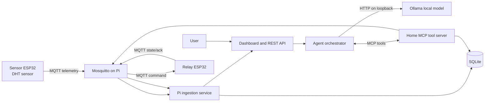

# A-SENSE Product and Implementation Brief

**Purpose:** This document is the implementation source of truth for coding agents building the A-SENSE prototype.

**Project title:** A-SENSE: An Autonomous Multi-Agent Orchestration Framework for Proactive Home Management using MCP and Localized LLMs.

**Current prototype hardware:** Raspberry Pi 5 (4 GB), two ESP32 boards, one DHT-series temperature/humidity sensor, and one relay module.

**Current setup status:** Raspberry Pi OS is running as a 64-bit ARM system and is reachable through Raspberry Pi Connect and SSH. Mosquitto and its client tools are installed; the Mosquitto service was confirmed active. Ollama/model installation is in progress. Do not store passwords, Wi-Fi credentials, or tokens in this document or in source control.

## 1. Product Summary

A-SENSE is a local-first home assistant. The Raspberry Pi is the system host: it receives sensor data, stores state and history, hosts the user interface and agent API, runs a small local language model, and sends validated device commands over MQTT. The ESP32 boards are device nodes: one measures temperature and humidity; the other receives commands and operates one relay.

The initial product must demonstrate a complete, understandable loop:

1. The sensor ESP32 reads room temperature and humidity.
2. It publishes readings to the Raspberry Pi over Wi-Fi and MQTT.
3. The Pi records and displays the latest readings.
4. A user asks the local agent for the room conditions or asks it to switch the relay.
5. The agent requests an approved tool through MCP.
6. The Pi validates the request, publishes a command to MQTT, and waits for the relay ESP32 to report its actual state.
7. The interface reports the confirmed result and records the action.

The MVP is designed to keep working when cloud AI services are unavailable. Weather forecasts and external messaging require internet connectivity and belong to a later phase.

## 2. Goals and Non-Goals

### MVP goals

- Run the broker, application, database, MCP tool server, and local model on the Raspberry Pi 5.
- Ingest temperature and humidity from one DHT sensor node.
- Control and observe one relay node.
- Provide a LAN web dashboard and a natural-language chat endpoint.
- Let the local model choose among a small, explicit set of device tools.
- Validate every requested action in application code before publishing it.
- Keep an auditable event history of readings, commands, confirmations, and errors.
- Demonstrate one opt-in temperature automation after manual control is reliable.
- Keep device control and simple automations functional if Ollama is stopped.

### Later goals

- Proactive local notifications, schedules, and reminders.
- Weather lookups and umbrella/rain notifications using a configured forecast provider.
- WhatsApp or another messaging adapter.
- More sensors, relays, rooms, and ESP32 nodes.
- Additional MCP tools and external research integrations.
- Power-cut notices only when an official utility schedule/feed exists; unexpected outages can only be detected after a suitable power/UPS sensor reports them.

### Explicitly out of scope for the first MVP

- Voice input/output, cameras, facial recognition, smart locks, and door access control.
- Publicly exposing the Ollama API or MQTT broker to the internet.
- Letting an LLM publish arbitrary MQTT messages, run shell commands, or access arbitrary files.
- Claiming that the model can predict unannounced power cuts without an external data source.
- Building a fleet of independent large models. Use one local model with small, modular software roles.

## 3. System Architecture

### Component responsibilities

- **Mosquitto:** Local message broker. Require credentials for network clients. Do not configure router port forwarding for MQTT.
- **Sensor ESP32:** Read the DHT sensor, publish telemetry and online/offline availability, reconnect after Wi-Fi/MQTT loss.
- **Relay ESP32:** Start with the relay off, accept only documented ON/OFF commands, report state and command acknowledgement, reconnect after Wi-Fi/MQTT loss.
- **Pi ingestion service:** Subscribe to telemetry, validate payloads, timestamp receipt, update device availability, and persist readings/events.
- **FastAPI application:** Serve the dashboard and JSON API, enforce user/device policies, expose health and state, and coordinate the agent.
- **Ollama:** Run the selected local model. Keep the Ollama API bound to loopback (`127.0.0.1:11434`). The model proposes tool calls; it does not operate GPIO or MQTT directly.
- **Agent orchestrator:** Run a bounded tool-call loop, authorize tools, validate arguments and fresh state, execute tools through MCP, verify device results, and return a concise response.
- **MCP tool server:** Expose the home-control functions as actual MCP tools. Keep device/MQTT logic behind this boundary.
- **SQLite:** Store readings, device state, rules/preferences, and an action/event audit trail.
- **Dashboard:** Show live state and history, provide manual relay controls, show agent messages, and expose automation settings.

## 4. Hardware and Wiring Assumptions

Hardware part numbers are not yet confirmed. The implementation must keep pin numbers, relay polarity, sensor type, MQTT credentials, Wi-Fi credentials, and broker address configurable. Do not silently assume a relay module is active-high or that its input accepts 3.3 V.

### Sensor node

- Use a GPIO appropriate for the exact ESP32 variant; GPIO 4 is only a suggested starting point for a classic ESP32 DevKit.
- Power the DHT module according to its documentation. Connect data to the selected ESP32 GPIO and connect grounds as required by the module.
- A bare DHT sensor may need a pull-up resistor; a breakout board may already contain one.
- Do not drive ESP32 GPIO with 5 V logic.
- Read at a conservative interval (10 seconds is suitable for the demo); reject non-finite/invalid readings.

### Relay node

- Suggested classic ESP32 DevKit control pin: GPIO 26, subject to the actual board pinout.
- Use the relay module's specified supply. Never power a relay coil from an ESP32 GPIO.
- Configure relay polarity as a setting (`ACTIVE_LOW`/`ACTIVE_HIGH`) and set OFF before enabling output at boot.
- Verify relay operation with no load first, then use only an isolated low-voltage DC demo load within the relay module ratings.
- Household mains wiring is not part of the software quick-start. Any mains installation must be performed by a qualified electrician using a correctly enclosed and rated assembly.

## 5. MQTT Contract

Use the prefix `asense/v1/`. Use stable identifiers, JSON payloads for telemetry/state, and UTC timestamps where the node has valid time. Include `uptime_ms` if time synchronization is unavailable. Do not place secrets in MQTT payloads.

| Topic | Publisher | Subscriber | Payload/behavior |
|---|---|---|---|
| `asense/v1/sensors/room1/telemetry` | Sensor ESP32 | Pi ingestion | JSON: `device_id`, `temperature_c`, `humidity_pct`, `sampled_at` or `uptime_ms`, `sequence` |
| `asense/v1/devices/sensor-01/status` | Sensor ESP32 | Pi ingestion | `online`/`offline`; configure an MQTT Last Will so unexpected disconnects become offline |
| `asense/v1/actuators/relay-01/set` | Pi tool/app | Relay ESP32 | JSON command: `command_id`, `state` (`ON` or `OFF`), `requested_by`, `issued_at` |
| `asense/v1/actuators/relay-01/state` | Relay ESP32 | Pi ingestion/UI | JSON report: `command_id`, actual `state`, `reported_at`; retain the most recent state |
| `asense/v1/devices/relay-01/status` | Relay ESP32 | Pi ingestion | `online`/`offline`; use Last Will |
| `asense/v1/events/relay-01/ack` | Relay ESP32 | Pi command handler | JSON acknowledgement with `command_id`, accepted/rejected result, actual state, and optional error |

Suggested QoS: QoS 0 for periodic telemetry; QoS 1 for relay commands, state, availability, and acknowledgements. Relay commands must be idempotent: repeating `ON` leaves the relay on. Never interpret arbitrary strings as commands.

Command handling requirements:

- Generate a unique command ID for each action.
- Wait a bounded time for acknowledgement/state confirmation.
- Return timeout or offline errors instead of claiming success.
- Mark a device stale/offline if no telemetry or status arrives within a configurable interval.
- Do not execute automation using stale sensor data.

## 6. Local API Contract

The web application listens on the LAN at a configurable port, default `8000`. Ollama stays on loopback and is called server-to-server by the Pi application.

| Method and path | Purpose |
|---|---|
| `GET /api/health` | App, MQTT, database, and model availability summary; do not leak credentials |
| `GET /api/state` | Latest room readings, freshness, device availability, relay state, current mode |
| `GET /api/readings?limit=100` | Recent persisted sensor readings with a bounded maximum limit |
| `GET /api/events?limit=50` | Recent commands, agent actions, status changes, alerts, and errors |
| `POST /api/agent/chat` | Accept `{ "message": "...", "conversation_id": "optional" }`; return answer plus structured actions/results |
| `POST /api/devices/relay-01/command` | Manual command `{ "state": "ON" | "OFF" }`; enforce policy and return confirmed state or error |
| `GET /api/automation` | Read enabled automation rules and settings |
| `PUT /api/automation/temperature` | Configure an explicit user-approved temperature rule and thresholds |

Use Pydantic request/response models, clear HTTP error codes, input size limits, and structured JSON logs. The LAN API must not be anonymously exposed beyond the trusted home network. Add authentication before any remote/public exposure.

## 7. MCP Tools and Agent Behavior

### Initial allow-listed MCP tools

- `get_room_readings`: Return the latest temperature/humidity values, sample time, and freshness status.
- `get_relay_state`: Return the latest reported relay state and relay node availability.
- `set_relay_state`: Accept only `ON`/`OFF` and an optional short reason; send a command through the Pi MQTT client and wait for confirmation.
- `get_recent_events`: Return a small bounded list of recent user-visible events.
- `get_user_preferences`: Return relevant approved settings, such as temperature thresholds and automation mode.

The model must not receive a generic MQTT publish tool, raw GPIO access, shell access, unrestricted database access, or arbitrary HTTP fetch access.

### Agent loop

1. Receive a user request at `POST /api/agent/chat`.
2. Load only the needed recent conversation state, current device summary, user preferences, and available tool schemas.
3. Ask Ollama for a response/tool call using a small configured context (start at 2,048 tokens on the 4 GB Pi and tune after measuring).
4. If there is no tool call, return the model's text response.
5. If there is a tool call, verify its exact name, schema, argument values, current user policy, device connectivity, and sensor freshness.
6. Execute only an approved MCP tool. For relay changes, publish an MQTT command and wait for the ESP32 acknowledgement/state report.
7. Add the tool result to the conversation and let the model formulate the final response. Limit the loop to a small configurable maximum (for example, 3 tool rounds) to prevent runaway calls.
8. Persist the user-visible request, chosen tool, arguments, result, timestamps, and errors. Do not persist hidden chain-of-thought as an audit requirement.

The agent may explain and recommend actions. In MVP, model-initiated relay changes require confirmation unless the user has enabled a specific, bounded automation. Manual dashboard commands are direct user actions and still require device confirmation.

## 8. Automation and Proactive Behavior

Start with one opt-in room-temperature rule, not open-ended autonomous control.

- Rule settings: enabled flag, upper threshold, lower reset threshold (hysteresis), permitted schedule, maximum run duration, and manual override state.
- Example behavior: if the latest fresh room temperature exceeds the user-set high threshold, notify the user or ask for approval. Only switch the relay automatically if the user explicitly enables that exact rule.
- Use hysteresis so the relay does not rapidly toggle around one threshold.
- Stop or pause if sensor data is stale, relay state is unknown, device is offline, rule is disabled, or safety constraints fail.
- Provide a visible manual/automatic mode and a way to cancel/override automation.

Weather alerts require a configured forecast provider and internet access. Power outage advance alerts require an official utility schedule/feed. Without such a feed, an appropriate voltage/UPS sensor can report an outage after it begins but cannot reliably predict it beforehand.

## 9. Data Model and Retention

Use SQLite with migrations or a simple versioned schema. Store timestamps in UTC and convert for display using the configured local timezone.

Initial tables:

- `sensor_readings(id, device_id, sampled_at, received_at, temperature_c, humidity_pct, sequence)`
- `device_state(device_id, kind, online, last_seen_at, reported_state, updated_at)`
- `commands(command_id, device_id, requested_state, source, status, requested_at, confirmed_at, error)`
- `events(id, occurred_at, event_type, severity, summary, details_json)`
- `preferences(key, value_json, updated_at)`
- `automation_rules(id, name, enabled, config_json, updated_at)`
- `conversations(id, created_at, updated_at)` and `messages(id, conversation_id, role, content, created_at)` only if chat history is enabled; provide a clear retention limit.

Avoid storing secrets in SQLite. Add a configurable retention policy for readings and conversations; do not let a small SD card fill indefinitely.

## 10. Dashboard Requirements

The dashboard is a simple responsive page served by the Pi app. It must show:

- Current temperature and humidity, sample age, and sensor online/offline status.
- Relay online/offline status and last confirmed state.
- Manual ON/OFF controls with a pending state, success/failure result, and no false success before acknowledgement.
- A natural-language chat panel with action/result summaries.
- A compact recent-event timeline.
- An automation section with explicit enable/disable, thresholds, mode, and override.
- Clear indication when the local model, MQTT, or a device is unavailable.

The essential controls must remain usable without the LLM. Build the first version with a lightweight frontend served by FastAPI; do not add a separate cloud frontend.

## 11. Recommended Technology Choices

- Raspberry Pi OS 64-bit on Raspberry Pi 5 4 GB.
- Mosquitto MQTT broker and command-line clients.
- Python 3, FastAPI, Uvicorn, `paho-mqtt`, SQLite, and the official Python MCP SDK.
- Ollama local runtime with a configurable small local model. Initial candidate: `qwen3.5:0.8b`; evaluate actual tool-call reliability and response latency on this Pi before treating it as capable.
- ESP32 firmware in Arduino IDE using Espressif's Arduino core, PubSubClient, and Adafruit DHT libraries.
- HTML/CSS/JavaScript dashboard served by the Pi app.
- `systemd` services for app and MCP server; automatic restart and boot start.

Keep model name, broker host, port, credentials, sensor type, GPIO mapping, relay polarity, and timing thresholds in environment/configuration, not scattered through source code. Store secrets in a local environment file with restrictive permissions; provide a `.env.example` containing placeholders only.

## 12. Delivery Milestones and Acceptance Criteria

### Milestone 0: Pi baseline

- Confirm `aarch64`, stable Pi address/reservation, system updates, disk and memory available.
- Mosquitto service is active and local publisher/subscriber test succeeds.
- Ollama service is active, selected model is downloaded, and a local HTTP chat request returns a response.

### Milestone 1: Sensor firmware

- Sensor ESP32 connects to Wi-Fi and broker with authentication.
- Serial output and MQTT telemetry show plausible temperature/humidity values.
- Invalid values are ignored/reported; node reconnects after broker restart.
- Pi can mark the sensor node offline after disconnect/Last Will.

### Milestone 2: Relay firmware

- Relay defaults to OFF at boot.
- ESP32 receives only valid `ON`/`OFF` commands and publishes confirmed state/ack.
- Relay behavior is verified with no load, then a low-voltage DC demo load.
- Pi detects timeout/offline and does not report unconfirmed success.

### Milestone 3: Pi application and persistence

- Backend subscribes to sensor/state/status topics.
- `/api/state`, `/api/readings`, `/api/events`, and `/api/health` return validated JSON.
- Readings and command events survive an application restart.
- Dashboard shows live-ish state and freshness/availability accurately.

### Milestone 4: MCP agent

- The backend sends a user message and the approved tool schemas to Ollama.
- A request such as “What is the room temperature?” calls the sensor tool and responds from real stored data.
- A request such as “Turn the relay on” requests confirmation or follows an explicitly enabled policy, publishes through MQTT, waits for relay confirmation, and reports the result.
- Unknown tools, malformed arguments, stale readings, offline devices, and MQTT timeout are handled safely and visibly.
- The application still supports dashboard controls and sensor display while Ollama is unavailable.

### Milestone 5: Automation and presentation

- A user-approved temperature rule works with hysteresis, schedule/override, and event logging.
- Demonstrate offline local operation for sensor, manual relay, and rule behavior.
- Add weather and external messaging only after a data provider and notification channel are configured.
- Prepare architecture diagram, setup guide, screenshots, and a demo script.

## 13. Demo Script

1. Show the Pi services and dashboard status.
2. Hold or warm the DHT sensor gently and show new temperature/humidity arriving.
3. Ask the local agent for the current room readings; show that it calls the sensor tool.
4. Ask the agent to turn the relay on; show command ID, MQTT command, ESP32 state report, and confirmed dashboard state.
5. Turn it off from the dashboard to show manual controls work independently of the model.
6. Enable a bounded high-temperature rule and demonstrate the alert/approved action.
7. Disconnect a node and show the stale/offline state and safe error behavior.

## 14. Coding Agent Implementation Instructions

- Inspect the existing repository and preserve user changes before editing.
- If the repository is empty, scaffold a small monorepo with `pi/`, `firmware/sensor_node/`, `firmware/relay_node/`, `docs/`, `.env.example`, and a root README.
- Implement the vertical slice in this order: broker contract/config, firmware nodes, Pi MQTT ingestion and SQLite, REST/dashboard, MCP server, bounded Ollama agent loop, then automation.
- Prefer explicit interfaces between MQTT, storage, MCP, model, and API layers. Do not entangle ESP32-specific assumptions with the agent prompt.
- Use environment variables/configuration for secrets and hardware variants. Do not commit real credentials.
- Keep the main path runnable on Raspberry Pi OS ARM64 and document commands for installing, starting, and checking every service.
- Include safe simulator/mock adapters so backend/agent logic can be developed before hardware firmware is ready.
- Return structured errors for unavailable broker/model/devices; never turn network failure into a fabricated success.
- Keep the initial UI/API local-network-only. Do not add port forwarding or public access instructions.
- Treat this brief as product requirements, not as permission to access external accounts, publish data, or control real household mains wiring.

## 15. Open Hardware Details to Confirm Before Final Wiring/Firmware

- Exact ESP32 board variants (classic ESP32, C3, S3, etc.) and their pinouts.
- Exact sensor model (DHT11, DHT22/AM2302, or a breakout/module) and whether it has an onboard pull-up.
- Exact relay module model, supply voltage, input trigger level/polarity, and isolation details.
- Low-voltage demonstration load voltage/current and the power supply rating.
- Local Wi-Fi details are entered directly into local configuration; never put them in this document or chat.

Until those are confirmed, keep pins and relay polarity configurable and test relay logic with no load attached.

## 16. Primary References

- Raspberry Pi remote access and Connect: https://www.raspberrypi.com/documentation/remote-access.html
- Ollama Linux install: https://ollama.com/download/linux
- Ollama chat API: https://docs.ollama.com/api/chat
- Ollama tool calling: https://docs.ollama.com/capabilities/tool-calling
- Qwen model catalog and sizes: https://ollama.com/library/qwen3.5
- Mosquitto authentication: https://mosquitto.org/documentation/authentication-methods/
- Mosquitto configuration reference: https://www.mosquitto.org/man/mosquitto-conf-5.html
- Espressif Arduino core installation: https://docs.espressif.com/projects/arduino-esp32/en/latest/installing.html
- Adafruit DHT wiring: https://learn.adafruit.com/dht/connecting-to-a-dhtxx-sensor
- Adafruit DHT Arduino library: https://github.com/adafruit/DHT-sensor-library
